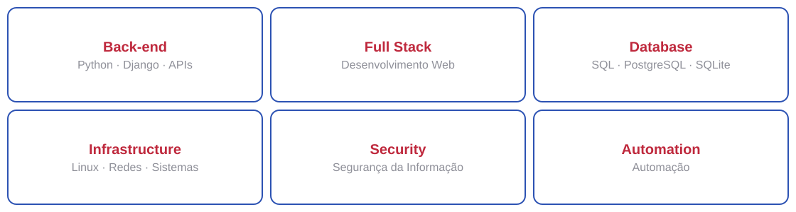
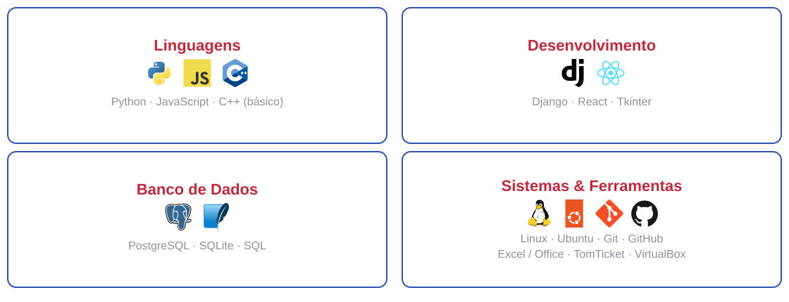

<table width="100%" border="0" cellpadding="12" cellspacing="0">
<tr>
<td width="45%" align="center" valign="middle">

</td>
<td width="60%" valign="middle">
<h2></h2>

Meu nome é Luciano Rocha, atualmente sou <strong>estagiário</strong>, cursando <strong>Sistemas de Informação - UEMG</strong> e <strong>Segurança da Informação - UniRitter</strong>, e busco oportunidades como <strong>Trainee ou Desenvolvedor Júnior</strong>.

Desenvolvo experiência por meio de projetos próprios e acadêmicos. Tenho <strong>5 anos de experiência profissional com Excel e Pacote Office</strong>, principalmente na automação de planilhas e geração de relatórios.

Essa experiência despertou ainda mais meu interesse por tecnologia, automação e desenvolvimento de soluções, motivando minha evolução profissional na área de TI.

Atualmente estou estudando <code>Banco de Dados</code> · <code>Redes</code> · <code>Infraestrutura</code> · <code>Segurança da Informação</code>.

</td>
</tr>
</table>

<h2></h2>

<h2></h2>

<h2></h2>

<table width="100%" border="0" cellpadding="12" cellspacing="0">
<tr>
<td width="55%" valign="middle">
<h3>Em desenvolvimento</h3>
<ul>
  <li>Landing page para clínica estética, com foco na apresentação de serviços.</li>
  <li>Aplicativo desktop para controle financeiro pessoal e acompanhamento de gastos.</li>
  <li>API para recomendar playlists musicais com base no humor.</li>
  <li>Ferramenta privada para automação de processos.</li>
  <li>Projeto privado para centralizar ferramentas e fluxos de trabalho.</li>
</ul>
</td>
<td width="45%" align="center" valign="middle">

</td>
</tr>
</table>

<h2></h2>

Aprofundar conhecimentos em **desenvolvimento, infraestrutura e Segurança da Informação**, enquanto continuo construindo projetos práticos.

<h2></h2>

`Trainee` · `Desenvolvedor Júnior` · `Helpdesk` · `Suporte` · `Infraestrutura` · `Cybersegurança`

<h2></h2>

